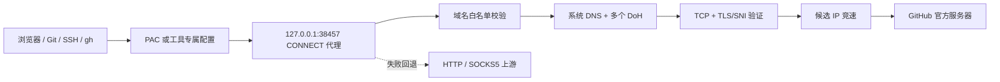

<p align="center">
  
</p>

<h1 align="center">GitHub Link</h1>

<p align="center">
  面向 macOS 的 GitHub 稳定连接工具。通过本地选择性代理、独立 DNS、候选 IP 验证和故障自动切换，改善 GitHub 网页、Git、SSH、Raw 与 Release 下载的连接质量。
</p>

> GitHub Link 不是 GitHub 官方产品，也不是通用 VPN。它只处理配置白名单内的 GitHub 域名。

## 功能

| 功能 | 说明 |
|---|---|
| GitHub 专用 CONNECT 代理 | 只接受回环连接，只放行 GitHub 域名和 `443/22` 端口 |
| DNS 聚合 | 并行使用系统 DNS、腾讯 DoH、阿里 DoH 和 Cloudflare DoH |
| 候选 IP 优选 | 对 A/AAAA 地址执行 TCP 与官方 TLS 证书验证，保留最多 3 个候选 |
| 故障切换 | 双 IP 错峰竞速；TLS 首包超时后重放 ClientHello 并切换候选 IP |
| Git HTTPS | 使用独立 Git include 文件接入本地代理，不覆盖其他 Git 配置 |
| GitHub SSH | 代理 SSH 连接，`github.com:22` 不可用时回退 `ssh.github.com:443` |
| PAC 自动代理 | 仅将 GitHub 网页及静态资源域名交给本地代理，其余流量保持直连 |
| 上游代理 | 支持 HTTP CONNECT 和 SOCKS5，可在优化直连失败时自动回退 |
| 菜单栏 App | 展示线路、评分、候选 IP、TCP/TLS 延迟、错误和代理设置 |
| CLI | 提供启停、诊断、探测、线路切换、命令代理和配置恢复 |

## 工作原理



HTTPS 建立 CONNECT 后，GitHub Link 只转发原始 TLS 字节。证书校验仍由浏览器、Git 或 curl 完成。

## 安全边界

| 项目 | 策略 |
|---|---|
| 自签 CA | 不生成、不安装 |
| HTTPS 解密 | 不进行中间人解密 |
| Git `http.sslverify` | 不读取、不修改，始终保持原有验证策略 |
| GitHub Token | 不读取、不保存 |
| SSH 私钥 | 不读取、不修改 |
| 监听范围 | 仅 `127.0.0.1` |
| 目标范围 | GitHub 域名白名单，端口仅 `443/22` |
| 配置修改 | 使用独立 include 文件，修改前创建备份，可执行 `restore` |

## 系统要求

- macOS 14 或更高版本
- Apple Silicon，目前 Release 提供 `arm64` 构建
- V1 为个人未公证构建，首次启动可能需要在 Finder 中右键选择“打开”

## 安装

1. 从 [Releases](https://github.com/hylf2/github-link/releases) 下载 `GitHub-Link-v0.1.0-macos-arm64.zip`。
2. 解压后打开 `GitHub Link.app`。
3. 点击右上角电源按钮启用服务。
4. App 会安装用户级 launchd 服务，并接入 Git HTTPS 与 SSH 配置。

浏览器访问还需要进行一次 PAC 设置：

1. 在 App 的“设置”页面复制 PAC 地址，默认是 `http://127.0.0.1:38458/proxy.pac`。
2. 打开“系统设置 → 网络 → 当前网络 → 详细信息 → 代理”。
3. 启用“自动代理配置”并填入 PAC 地址。

## 线路模式

| 模式 | 行为 |
|---|---|
| 自动 | 优先优化直连，失败后使用已配置的上游代理 |
| 优化直连 | 聚合 DNS、验证候选 IP、执行 IP 竞速与 TLS 首包切换 |
| 上游代理 | 固定使用 HTTP CONNECT 或 SOCKS5 上游 |
| 普通直连 | 使用系统 DNS 直接连接，用于对照与排障 |

## CLI

启用 App 后，CLI 会安装到：

```text
~/Library/Application Support/GitHubLink/bin/github-link
```

常用命令：

```bash
github-link enable
github-link disable
github-link status --json
github-link probe --json
github-link route auto
github-link route optimized_direct
github-link route upstream
github-link route plain_direct
github-link exec -- gh api /zen
github-link doctor --json
github-link restore
```

## 本地接口

| 服务 | 默认地址 |
|---|---|
| CONNECT 代理 | `127.0.0.1:38457` |
| PAC 服务 | `127.0.0.1:38458` |
| 控制接口 | `~/Library/Application Support/GitHubLink/control.sock` |
| 配置文件 | `~/Library/Application Support/GitHubLink/config.toml` |

## 源码构建

需要 Rust、Cargo、Node.js、npm 和 Xcode Command Line Tools。

```bash
npm install
cargo test --workspace
npm test
npm run tauri build
```

构建结果：

```text
target/release/bundle/macos/GitHub Link.app
```

详细设计参见 [docs/architecture.md](docs/architecture.md)。

## 项目来源

项目借鉴了 [FastGithub](https://github.com/dotnetcore/FastGithub) 的选择性代理、独立 DNS 和 IP 优选思路，使用 Rust/Tauri 进行 clean-room 重写。GitHub Link 不采用 FastGithub 的自签 CA、HTTPS 中间人、关闭 Git TLS 校验或 Windows 数据包截获方案。

## License

[MIT](LICENSE)
