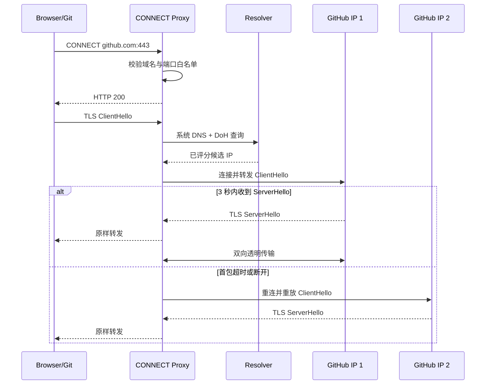

# GitHub Link 技术架构

## 组件

| 组件 | 技术 | 职责 |
|---|---|---|
| `github-link-core` | Rust、Reqwest、Rustls | 配置、DNS/DoH、候选 IP、TLS 验证、镜像发现与测速 |
| `github-link-proxy` | Tokio、Hyper | HTTP CONNECT、PAC、TLS 首包重放、上游代理 |
| `github-linkd` | Tokio、launchd | 后台服务、Unix Socket 控制协议、周期探测和日志 |
| `github-link` | Clap | 启停、诊断、Git/SSH 接入、命令代理和恢复 |
| `GitHub Link.app` | Tauri 2、React、TypeScript | 菜单栏、状态展示、线路与上游代理配置 |

## HTTPS 数据流



代理不会生成站点证书，也不会读取 TLS 内的 HTTP 请求内容。

## IP 选择

1. 系统 DNS 与多个 DoH Provider 并行查询，单个请求超时 2 秒。
2. 合并 A/AAAA 记录，去除回环、私网、链路本地和重复地址。
3. 对候选 IP 执行 TCP 连接和带原始域名 SNI 的 Rustls 握手。
4. 按连接耗时计算评分，保留最多 3 个候选，正常缓存 10 分钟。
5. 实际连接对前两个候选错峰 150ms 发起，首个成功连接胜出。
6. TCP 成功但 TLS 首包停滞时，缓存 ClientHello 并换 IP 重放。

## 下载镜像加速

下载镜像是与透明 CONNECT 代理相互独立的可选通道：

1. 从 `https://github.akams.cn/` 服务端 HTML 提取贡献或测绘节点，并合并内置候选。
2. 只保留合法 DNS 主机名，最多并发探测 16 个节点。
3. 对公开下载链接执行带 `Range: bytes=0-1023` 的目标级二次测速。
4. 选择一个成功响应最快的节点，生成 `https://node/https://github.com/...` 地址。
5. 10 分钟内复用候选缓存，后台仅在功能启用时周期刷新。

该通道只接受 Release、Archive、Raw、Gist 和 Codeload 公开 URL，不接受 API、认证信息或普通 GitHub 页面。第三方节点无法访问本地 Cookie、Token 或 SSH 私钥。

## 配置所有权

GitHub Link 只管理下列文件或标记块：

```text
~/.config/github-link/gitconfig
~/.ssh/config.d/github-link
~/Library/Application Support/GitHubLink/
~/Library/LaunchAgents/com.fengc.github-linkd.plist
```

`~/.gitconfig` 只增加独立 `include.path`。`~/.ssh/config` 只增加带明确开始/结束标记的 Include 块。执行 `github-link restore` 时只删除这些受管内容，不覆盖用户后续修改。

## 控制协议

App 和 CLI 通过权限为 `0600` 的 Unix Domain Socket 与 daemon 通信。请求和响应使用单行 JSON，支持：

- `status`
- `probe`
- `refresh_mirrors`
- `accelerate`
- `set_route`
- `reload`
- `shutdown`

控制接口不监听 TCP 端口，不对局域网暴露。

## 已知边界

- 当前 Release 仅构建 macOS arm64。
- App 尚未使用 Apple Developer ID 签名和公证。
- 不内置收费中转节点；HTTP/SOCKS5 上游需要用户自行配置。
- 下载镜像来自第三方公益服务，其可用性、速度和内容完整性不在本项目控制范围内。
- V1 不自动修改 macOS 系统代理，浏览器 PAC 需要用户手动启用一次。
